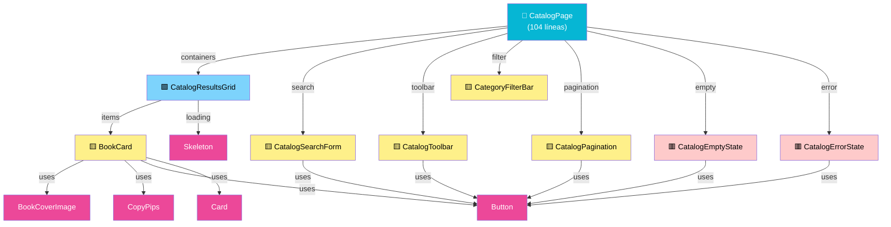
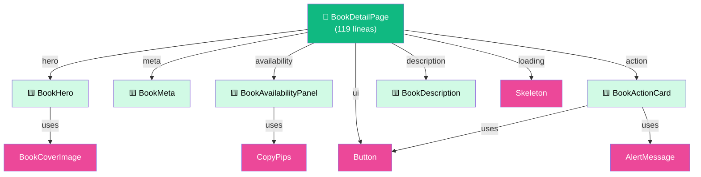
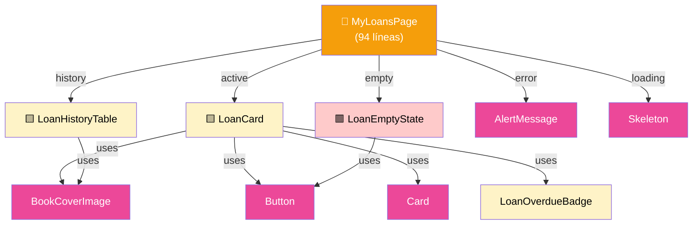

# Diagrama de Dependencias (Mermaid)

Estos diagramas pueden visualizarse en:

- GitHub (automáticamente renderizado)
- [Mermaid Live Editor](https://mermaid.live)

## 1. Flujo de Páginas

```mermaid
graph TD
    App["App.tsx<br/>Router Provider"]

    App -->|Route: /*| AppLayout["AppLayout<br/>(Navbar + Footer)"]
    AppLayout -->|Button| Button["Button (UI)"]

    AppLayout -->|Route: /| CatalogPage["CatalogPage"]
    AppLayout -->|Route: /book/:id| BookDetailPage["BookDetailPage"]
    AppLayout -->|Route: /loans| MyLoansPage["MyLoansPage"]
    AppLayout -->|Route: /login| AuthPage["AuthPage"]

    CatalogPage -->|uses| CategoryFilterBar["CategoryFilterBar"]
    CatalogPage -->|uses| CatalogSearchForm["CatalogSearchForm"]
    CatalogSearchForm -->|uses| Button
    CatalogPage -->|uses| CatalogToolbar["CatalogToolbar"]
    CatalogToolbar -->|uses| Button
    CatalogPage -->|uses| CatalogResultsGrid["CatalogResultsGrid"]
    CatalogResultsGrid -->|uses| BookCard["BookCard"]
    BookCard -->|uses| BookCoverImage["BookCoverImage"]
    BookCard -->|uses| CopyPips["CopyPips"]
    BookCard -->|uses| Button
    BookCard -->|uses| Card["Card (UI)"]
    CatalogResultsGrid -->|uses| Skeleton["Skeleton (UI)"]
    CatalogPage -->|uses| CatalogEmptyState["CatalogEmptyState"]
    CatalogEmptyState -->|uses| Button
    CatalogPage -->|uses| CatalogErrorState["CatalogErrorState"]
    CatalogErrorState -->|uses| Button
    CatalogPage -->|uses| CatalogPagination["CatalogPagination"]
    CatalogPagination -->|uses| Button

    BookDetailPage -->|uses| BookHero["BookHero"]
    BookHero -->|uses| BookCoverImage
    BookDetailPage -->|uses| BookMeta["BookMeta"]
    BookDetailPage -->|uses| BookAvailabilityPanel["BookAvailabilityPanel"]
    BookAvailabilityPanel -->|uses| CopyPips
    BookDetailPage -->|uses| BookActionCard["BookActionCard"]
    BookActionCard -->|uses| Button
    BookActionCard -->|uses| AlertMessage["AlertMessage (UI)"]
    BookDetailPage -->|uses| BookDescription["BookDescription"]
    BookDetailPage -->|uses| Button
    BookDetailPage -->|uses| Skeleton

    MyLoansPage -->|uses| AlertMessage
    MyLoansPage -->|uses| LoanCard["LoanCard"]
    LoanCard -->|uses| BookCoverImage
    LoanCard -->|uses| Button
    LoanCard -->|uses| Card
    LoanCard -->|uses| LoanOverdueBadge["LoanOverdueBadge"]
    MyLoansPage -->|uses| LoanEmptyState["LoanEmptyState"]
    LoanEmptyState -->|uses| Button
    MyLoansPage -->|uses| LoanHistoryTable["LoanHistoryTable"]
    LoanHistoryTable -->|uses| BookCoverImage
    MyLoansPage -->|uses| Skeleton

    AuthPage -->|uses| AlertMessage
    AuthPage -->|uses| AuthHeader["AuthHeader"]
    AuthPage -->|uses| AuthModeSwitcher["AuthModeSwitcher"]
    AuthPage -->|uses| Button
    AuthPage -->|uses| Card

    style App fill:#4f46e5
    style AppLayout fill:#7c3aed
    style CatalogPage fill:#06b6d4
    style BookDetailPage fill:#10b981
    style MyLoansPage fill:#f59e0b
    style AuthPage fill:#ef4444
    style Button fill:#ec4899,color:#fff
    style Card fill:#ec4899,color:#fff
    style BookCoverImage fill:#ec4899,color:#fff
    style AlertMessage fill:#ec4899,color:#fff
    style Skeleton fill:#ec4899,color:#fff
```

## 2. Árbol de Reutilización (Top-Down)

```mermaid
graph TD
    Button["🌟 Button<br/>(11 usos)"]

    Button -->|CatalogSearchForm| CatalogSearchForm
    Button -->|CatalogToolbar| CatalogToolbar
    Button -->|CatalogPagination| CatalogPagination
    Button -->|CatalogEmptyState| CatalogEmptyState
    Button -->|CatalogErrorState| CatalogErrorState
    Button -->|BookCard| BookCard
    Button -->|BookActionCard| BookActionCard
    Button -->|LoanCard| LoanCard
    Button -->|LoanEmptyState| LoanEmptyState
    Button -->|AuthPage| AuthPage
    Button -->|AppLayout| AppLayout

    BookCoverImage["🌟 BookCoverImage<br/>(4 usos)"]
    BookCoverImage -->|BookCard| BookCard
    BookCoverImage -->|BookHero| BookHero
    BookCoverImage -->|LoanCard| LoanCard
    BookCoverImage -->|LoanHistoryTable| LoanHistoryTable

    CopyPips["🌟 CopyPips<br/>(3 usos)"]
    CopyPips -->|BookCard| BookCard
    CopyPips -->|BookAvailabilityPanel| BookAvailabilityPanel

    AlertMessage["🌟 AlertMessage<br/>(3 usos)"]
    AlertMessage -->|AuthPage| AuthPage
    AlertMessage -->|BookActionCard| BookActionCard
    AlertMessage -->|MyLoansPage| MyLoansPage

    Card["🌟 Card<br/>(2 usos)"]
    Card -->|BookCard| BookCard
    Card -->|LoanCard| LoanCard

    Skeleton["🌟 Skeleton<br/>(2 usos)"]
    Skeleton -->|CatalogResultsGrid| CatalogResultsGrid
    Skeleton -->|BookDetailPage| BookDetailPage

    style Button fill:#ec4899,color:#fff
    style BookCoverImage fill:#ec4899,color:#fff
    style CopyPips fill:#ec4899,color:#fff
    style AlertMessage fill:#ec4899,color:#fff
    style Card fill:#ec4899,color:#fff
    style Skeleton fill:#ec4899,color:#fff
```

## 3. Estructura por Dominio (Catalog)

## 4. Estructura por Dominio (Book Detail)

## 5. Estructura por Dominio (Loans)

## Leyenda

| Símbolo | Significado                      |
| ------- | -------------------------------- |
| 📄      | Página (Entry Point)             |
| 🟩      | Contenedor/Container             |
| 🟨      | Componente Presentacional        |
| 🟥      | Empty State / Error State        |
| 🌟      | Altamente Reutilizado            |
| (UI)    | Componente Base de UI Primitivos |
